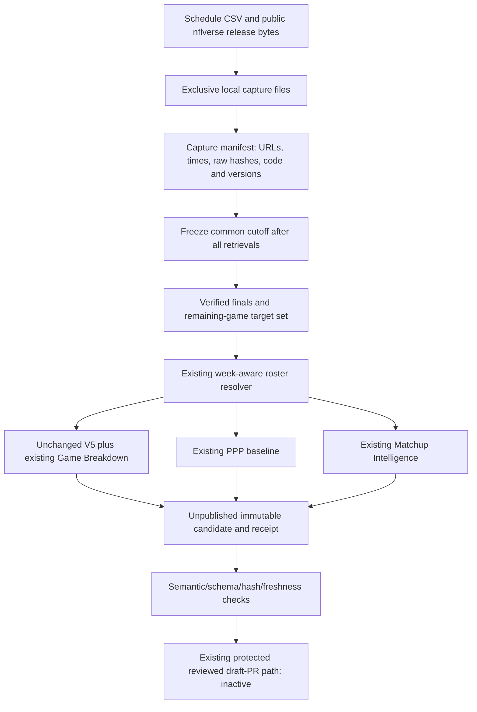

# Milestone 9 — captured weekly data pipeline

## Scope and status

Stage A was delivered in the chat audit on 2026-10-30; no report file existed at implementation start. This document records that approved audit and Stage B implementation. Branch: `feature/nfl-pm-weekly-data-pipeline`, based on `2e6d15ba75d5a1b4515c68e9ec4fddeb9452de3e` (Milestones 7 and 8 merged). Development only: no commit, push, PR, merge, production publication, deployment, settings change or schedule activation is authorized.

The audit found separate sidecar contracts but no common captured-input producer, a start-of-download cutoff, missing PPP capture fields, full-week/remaining-week disagreement, unresolved TRD eligibility, score-presence-only final inference, missing hosted validation dependencies, and an obsolete production verification hostname. Existing 13 JSON files are preserved. Legacy Week 7 contains historical backfills; legacy Weeks 8–9 lack publication receipts/model fingerprints and have unknown future outcomes stored as false. They are not rewritten or promoted as verified evidence by this milestone.

## Architecture



`weekly_data.py` orchestrates. `weekly_capture.py` saves exact HTTP response bytes and metadata; `CapturedSources` reads only pinned local files through the existing source/eligibility policies. No network fallback occurs on replay. `weekly_pipeline.py generate` now uses capture-based core generation; optional features require an explicit local `--features` choice. Existing workflow calls remain core-only and do not pass the Game Predictor publishing opt-in.

## Source inventory and time semantics

| Fields | Source/retrieval | Cadence/history | Treatment |
|---|---|---|---|
| Season/week, canonical game/team IDs, scheduled kickoff, scores | nflverse `schedules/games.csv`, raw CSV GET | In-season updates approximately every five minutes; multi-season current feed | Raw bytes retained; selected target games must be upcoming at frozen cutoff. Source odds columns are retained only as original raw bytes and never consumed as model inputs. |
| Targets, carries, receptions, TDs, yards, target share, historical player/game position | `stats_player/stats_player_week_YEAR.parquet` | Nightly/game-day updates and corrections; three prior seasons plus current season captured | Required observed fields and completed-game coverage validated; target/future weeks excluded. |
| Play IDs, run/pass types, drives, field position, yards, player IDs, TD attribution | `pbp/play_by_play_YEAR.parquet` | Nightly/game-day updates; revised historical releases | Captured for all four input seasons. Only verified prior finals enter history. |
| PAT, two-point and field-goal evidence, return TD flag and descriptions | Same raw PBP | Same cadence | Preserved for the existing offensive-drive PPP implementation; missing required PPP fields suppress that sidecar, not invented zeros. |
| Explicit END GAME event and terminal score totals | Same raw PBP | Postgame event evidence | Must corroborate schedule scores. Conflicting/missing terminal evidence fails closed for required historical games. |
| Target-week membership, team, position, roster status | `weekly_rosters/roster_weekly_YEAR.parquet` | Daily roster updates; weekly datasets since 2002 | Prefer target-week records. An unresolved relevant record blocks core generation. |
| Season membership fallback | `rosters/roster_YEAR.parquet` | Latest season roster | Allowed by existing live core policy; never proof of historical/target-week membership for Matchup Intelligence. |
| GSIS and corroborating stable IDs | `players/players.parquet` | Current crosswalk; no original historical vintage guarantee | Preserve authoritative/corroborated-ID policy; no name-only identity merge. |
| Injury designation | `injuries/injuries_YEAR.parquet` | Daily provider updates; historical series since 2009 | Optional. Missing, null or unavailable designations remain Unknown. Membership, injury designation and game-day activation remain distinct. |
| EPA/success | Optional PBP EPA | Same PBP release | Preserved if present; unavailable data is not synthesized. |
| Snaps, personnel, routes, coverage, weather, odds features | No new integrated source | Source-specific availability and terms | Not fabricated or introduced as inputs. |

Provider references: [update schedule](https://nflreadr.nflverse.com/articles/nflverse_data_schedule.html), [roster statuses](https://nflreadr.nflverse.com/articles/dictionary_roster_status.html), [nflreadpy source/license documentation](https://nflreadpy.nflverse.com/). The library is MIT; data licensing is separate, generally CC-BY-4.0 with source-specific exceptions such as FTN's share-alike terms. Retain attribution and review any added source separately.

Retrieval timestamps are measured by the capture process; provider Last-Modified is recorded separately or null. Old modification dates on historical files are not presented as recent provider updates. A newly captured historical file is evidence available now, not evidence of its original historical pregame vintage. Raw hashes and code hashes detect changes; they do not independently attest wall-clock truth. Trusted runner execution, clock accuracy, review and externally retained artifact/run evidence remain part of the trust boundary.

## Guarantees and deliberate limitations

- Exclusive creation prevents replacement of captures/candidates. Replay checks every available raw file's size and SHA-256, safe paths and file inventory. Source/runtime/code differences fail closed.
- The common cutoff is after all source capture completions and before every targeted kickoff. Per-source capture age, source cutoff and generation age retain the existing 24-hour / 6-hour / 30-minute windows and ten-minute kickoff margin.
- A captured END GAME event with matching home/away terminal scores certifies a historical final. Non-empty scores or an In Progress state alone do not. Missing prior-final coverage is rejected rather than silently shortening history.
- Both sidecars receive the exact remaining-game target IDs; arbitrary subsets and started/final target games are rejected. Existing complete-game files and historical snapshots are never modified.
- TRD is excluded under the provider's documented practice-squad-release definition. INA remains pending; this does not assert that INA means released. Active rookies and verified zero-history roster members retain the existing V5 policy.
- The portable candidate receipt includes the capture manifest and its hash, source fingerprints, base-manifest binding and explicit core/three-feature completeness. Raw inputs stay outside publishable data paths. Optional failures are reported without an artifact or fallback prediction.
- Exact replay retains the original generation timestamp, source cutoff and captured inputs and requires the exact original runtime/dependencies/code. It is an offline reproduction of that run, not a newly fresh forecast. Current-time publication checks still reject stale candidates.
- Hosted validators use pinned pandas/NumPy/tzdata/jsonschema without needing generation-only network/Arrow/model-training imports. Publication checks preserve reviewed code identity and pinned generator version evidence; exact offline replay additionally requires the full original Python patch version.
- PPP is primary and the weekly producer supplies no ridge model. No calibrated win probability is emitted. V5, PPP, parlay and Market Check formulas and the purple UI are unchanged.

## Local commands — not publication commands

```powershell
python weekly_data.py capture-generate --capture work/NEW-inputs --candidate work/NEW-candidate --season 2026 --week 8 --features all
python weekly_data.py replay --capture work/NEW-inputs --candidate work/NEW-replay --season 2026 --week 8 --features all
python weekly_pipeline.py validate --candidate work/NEW-candidate
python validation_tools.py --base origin/main
node td-predictor-web/scripts/calculation-regression.mjs
```

Paths must be new and outside served public trees. No historical capture timestamp input or backdating option exists. Do not rerun the example week after it becomes ineligible. The legacy `historical` command is not an original-vintage replay or a production path; absent verified final evidence it refuses the historical plan.

## Unpublished real current-week run

Raw captures: `work/m9-live-inputs-20261030-v2/` (12 files; 78,986,223 raw bytes). Candidate: `work/m9-live-candidate-20261030-v2/`. Exact replay: `work/m9-live-replay-20261030-v2/`. These are untracked local evidence and must not enter a source PR, production directory or frontend build.

- Season/week: 2026 Week 8; 13 expected/generated remaining games, 407 expected/generated eligible players.
- Thursday CAR–GB is completed and excluded; earliest remaining kickoff is 2026-11-01T18:00:00Z.
- Retrieval interval: 2026-10-30T20:50:27.141057Z through 20:50:36.704782Z.
- Frozen source cutoff: 2026-10-30T20:50:36.705436Z; generated: 20:50:49.931046Z.
- Roster decisions: 407 include, 1,685 exclude, zero pending, using target-week records.
- All 407 outcomes null; all 407 injury designations Unknown. The captured Week 8 injury file has 278 rows, but its 12 explicit Out/Questionable designations are for already-completed CAR/GB. Week-level availability is not evidence of complete remaining-game injury coverage.
- Matchup labels: 302 Insufficient Data, 103 Neutral, 2 Favorable. Existing sample/identity/Wilson guards are unchanged; no claim of calibrated accuracy improvement.
- Game Predictor: 13 baseline-only projections, null win probabilities, no adjusted model.
- Both sidecars pass structural schemas and semantic publication validation. Every candidate file is byte-identical on offline replay.

| Artifact | SHA-256 |
|---|---|
| board.json | 4493917224912c1a879d3cfd896f0d815ea180209bba5317544689a499c249fe |
| breakdowns.json | 202238ad2180df2ac5d8e8654f9a3ce575dd1e07cdbc65dcc91810afc64a6512 |
| game-predictor.json | 83ea8ee7fc89e54af656370aab307e06df01fb97f94dc691bbcf067b54c27dba |
| matchup-intelligence.json | 91b1312997c127f8a7f0b3f9f8ae7799e77c6cf628e5ccc9565e9c35855fc841 |
| receipt.json | 208ead5567e2129d57269eecf96bde0dd989df19ea8785237d0a238f6f566da2 |
| capture manifest | c6489f9363dcad6bfbfbbfa4c4c9fd4efc51d9d912b27901e989f07890f8958a |

The first capture attempt stopped on a 404 at the old player_stats release path; it produced no candidate and was preserved separately. The corrected stats_player path matches the installed loader. Deliberate required-source failure, missing PPP evidence, absent weekly roster, pending INA, changed bytes/code, stale inputs and kickoff races are exercised with isolated synthetic tests. Historical original-pregame replay remains BLOCKED: no genuine archived pregame capture set was available. Current revised feeds and synthetic fixtures are not substitutes.

## Validation and release infrastructure

Local evidence is under `work/m9-*.log`. All 212 Python tests pass: 196 existing tests and 16 new tests for capture/replay, optional failures, required-source staleness and captured data-only PR/deployment/rollback integration. 35 Node tests, Ruff F checks, frontend ESLint, sidecar schemas, workflow YAML, 200 protected calculation comparisons, all five existing browser suites and the additional real captured-bundle browser check pass. The real-data browser check intercepts localhost responses only; it never changes the actual served manifest. Production files are compared byte-for-byte; protected source comparisons normalize only Git/Windows line endings without rewriting source. V5 scoring and red-zone function ASTs are identical to main. A validation-only run also succeeds with generation-only nflreadpy/pyarrow/sklearn/joblib imports explicitly blocked.

Clean Linux build: Node 24.22.1 / Next 16.4.3, normal `npm ci --no-audit --no-fund && npm run build`, exit code 0 including /_not-found. Build-only nonpersistent environment `sbx_n6KAYQO780tC4I0Etrft7gtXjxAl`, command `cmd_ce5c643368ba47d1ae340ae54d7e`, was stopped; no credentials, private input captures, ports, deployments or snapshots were supplied. Existing eslint-support and unrs-resolver install-script notices remain dependency maintenance limitations, not suppressed build failures.

Production verification now pins onopm.space throughout exact-commit alias checks, HTTP hashes, workflow URL and smoke allowlist. Team/project IDs, no-redirect credential handling, immutable archive checks, manifest-race checks and exact-main checks remain intact. Reviewed checks install trusted-base validation requirements (existing trusted automation pins only for the source-only bootstrap), test all bundle combinations, all Node tests, calculations and local browser flows. No permission escalation, privileged trigger or schedule is added. Generation retains raw inputs as a separate 30-day Actions artifact; archive verified evidence before retention expires. This is not permanent immutable storage.

## Intended changed-file inventory (26 files)

| File | Purpose |
|---|---|
| `weekly_capture.py` (new) | Exclusive raw HTTP capture, fingerprints, runtime identity, final-state corroboration and portable provenance checks |
| `weekly_data.py` (new) | Offline source adapter, remaining-game orchestration, optional sidecars, receipt completeness and exact replay |
| `artifact_schema.py` (new) | Structural sidecar schema checks alongside semantic checks |
| `validation_tools.py` (new) | Protected source/JSON audit and isolated synthetic browser fixtures |
| `test_weekly_data.py` (new) | Sixteen new regression tests, including full captured publication/rollback contract |
| `requirements-validation.txt` (new) | Minimal pinned sidecar validator dependencies |
| `requirements-automation.txt` | Add pinned JSON Schema validator for generation and tests |
| `weekly_sources.py` | Preserve full PPP/final-state/optional EPA capture columns |
| `weekly_generation.py` | Use post-retrieval common cutoff; restrict old report windows to verified finals |
| `weekly_pipeline.py` | Route generate through immutable capture; expose local feature selection |
| `weekly_schedule.py` | Explicit final-state/evidence handling instead of score-presence inference |
| `weekly_storage.py` | Enforce portable capture provenance on new captured candidates |
| `roster_eligibility.py` | Documented TRD exclusion; INA remains pending |
| `game_projection_artifact.py` | Optional exact remaining-game target IDs; PPP math untouched |
| `matchup_intelligence.py` | Optional exact remaining-game target IDs; matchup math untouched |
| `verify_publication.py` | Correct production origin and strict alias checks |
| `.github/workflows/reviewed-data-checks.yml` | Trusted-base validator dependencies and broader read-only regression checks |
| `.github/workflows/verify-published-data.yml` | Validator dependencies and correct production smoke URL |
| `.github/workflows/weekly-predictions.yml` | Explicit core-only captured generation; separate temporary raw-input artifact retention |
| `td-predictor-web/scripts/publication-smoke.mjs` | Correct approved production origin allowlist |
| `td-predictor-web/scripts/calculation-regression.mjs` (new) | Repeatable protected calculation comparisons against reviewed Git base |
| `td-predictor-web/scripts/weekly-data-smoke.mjs` (new) | Unpublished captured two-sidecar browser validation on localhost only |
| `test_matchup_intelligence.py` | Give synthetic historical schedule fixtures explicit final states |
| `test_weekly_automation.py` | Explicit fixture final states and consistent state transition |
| `test_reviewed_publication.py` | Correct expected production alias while retaining negative alias tests |
| `docs/milestone-9.md` (new) | Approved audit, implementation, real-run evidence, limits and Stage C plan |

Exclude all `work/` captures, candidates, replay output, screenshots, temporary browser/build outputs, caches and unrelated pre-existing untracked files from any later approved source commit. No files are staged by Stage B.

## Stage C and remaining activation gates

1. Review this uncommitted source and local evidence. Obtain separate approval before commit/push/PR.
2. Pass hosted checks on the reviewed source, including minimal validation dependencies and Linux production build; no production credentials in PR jobs.
3. Run a separately approved hosted unpublished capture with explicit optional feature selection; preserve capture/run artifacts externally before expiry. Do not enable feature publishing opt-ins or change the default core-only proposal workflow during this development task.
4. Reconfirm current schedule, roster, injuries, kickoff margin and source freshness. Generate a NEW candidate; this local development candidate is not approved for release and its code revision/runtime and freshness must not be bypassed.
5. Resolve the historical test requirement only with genuinely archived captures and trustworthy original timing. Otherwise report it blocked.
6. Confirm environment/main protections, independent reviewer access, Actions PR permission and required checks. Keep all schedules disabled. Make required checks run for bot PRs through the documented human workflow approval, never bypass them.
7. Separately approve any supervised draft data proposal and eventual production merge. Verify exact-SHA Ready deployment, onopm.space alias, every JSON hash and website behavior. Record last-known-good deployment and manifest for reviewed rollback; retain all snapshots.

Unknown remaining-player injuries, local rather than hosted capture attestation, unavailable historical pregame archives, hosted validation not yet run for these uncommitted changes, temporary artifact retention and the separate feature activation approvals remain release limitations. No production action is implied by successful local generation.

## Stage C preparation — approved hosted validation only

Final review corrected revision binding: a capture commit may be an ancestor of the publication checkout only when none of the fingerprinted pipeline source files changed. The same strict current-code hashes, pinned version evidence, manifest binding and freshness checks remain. A data-only commit no longer invalidates its own valid capture; code changes or unrelated revision histories still require regeneration. Two additional regressions cover this transition and the hosted job's permission boundaries.

The existing reviewed-data-checks workflow now contains a read-only fresh capture/replay job scoped to the opening of this same-repository feature PR only, after Python and frontend validation pass. It checks out the exact feature SHA, captures with the real hosted clock, requires both sidecars and complete coverage, replays byte-for-byte, rechecks live freshness, and uploads inputs, candidate, replay and validation summary under `milestone-9-capture-<run-id>-<attempt>`. It uses no production environment, credentials, dispatch or release command, and adds no schedule. Synchronizing other commits does not start another live capture automatically; an authorized rerun of the opening run can retry after a failed check.

Evidence retention requests 90 days in GitHub Actions. Confirm the actual artifact expiry and URL after a successful hosted run; this is bounded durable artifact retention, not permanent archival storage. Permanent archival beyond that expiry remains an owner-controlled follow-up requiring separate storage authorization. No hosted evidence exists until the feature push, draft PR and job succeed. The Stage B local capture above is historical development evidence and must not be reused as the fresh Stage C run after the revision-binding correction.

Review also found that the standalone retrospective Game Predictor evaluator relied on the old score-presence completion behavior. `game_projection_evaluate.py` now retains and hashes terminal-score columns, validates END GAME evidence before passing schedules to unchanged PPP/training functions, and rejects old caches lacking that evidence. This is the 27th intended source file, necessary to preserve evaluator operation under the stricter completion contract. No evaluation run, mathematical change, metric rewrite or existing dataset modification is performed. A dedicated regression covers both accepted terminal evidence and rejected score-only history.
